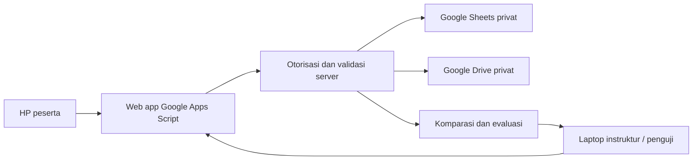

# PRD - Magnetic Practical Report (Sketch)

Versi: 1.1 | Tanggal: 31 Oktober 2026 | Status: rancangan untuk implementasi

Nama kerja produk: **MT Sketch Review**.

Dokumen ini menetapkan kebutuhan aplikasi Google Apps Script untuk membuat kunci jawaban, menerima sketch peserta melalui HP, dan memeriksa laporan melalui laptop. Pembagian pekerjaan tersedia dalam [FASE_PENGERJAAN.md](FASE_PENGERJAAN.md).

## 1. Tujuan dan keputusan produk

Instruktur membutuhkan cara yang konsisten untuk membandingkan indikasi pada benda uji yang sama. Peserta menggambar pada template yang disediakan, lalu mengisi data pengukuran setiap indikasi. Penguji membandingkan sketch dan data peserta dengan kunci jawaban, kemudian memberikan hasil evaluasi dan catatan.

**Keputusan pengguna:** versi pertama menggunakan komparasi visual dan selisih data; keputusan dan catatan diberikan oleh penguji. Nilai angka otomatis tidak termasuk versi pertama.

**Tambahan kebutuhan versi 1.1:** nomor indikasi otomatis berurutan dari kiri ke kanan, menggunakan From Y terkecil ke terbesar. Upload foto test piece menjadi fitur MVP yang opsional diisi pada kunci jawaban dan laporan peserta.

Hasil yang ingin dicapai:

- Peserta dapat membuat laporan lengkap dari browser HP dengan jari atau stylus.
- Instruktur membuat kunci dengan editor yang sama sehingga format kedua laporan konsisten.
- Penguji dapat melihat dua sketch berdampingan, menumpuk keduanya, dan memeriksa selisih data per indikasi.
- Data dapat dibuka kembali, ditelusuri versinya, dan dicetak sebagai laporan.
- Laporan peserta terikat pada benda uji, template, dan versi kunci yang tepat.

## 2. Dasar referensi dan batas interpretasi

Sumber utama adalah PDF pengguna, `MT Level II Practical Exam - SQT-2020 - REV 01.pdf`, terutama halaman PDF 3 dan 5, dihitung dari awal berkas.

| Temuan dalam referensi | Implikasi kebutuhan |
|---|---|
| Halaman 3 merupakan form MAGNETIC PRACTICAL REPORT (SKETCH) kosong | Menjadi dasar tata letak template dan keluaran laporan |
| Header Name, Date, Test Piece, Sign | Simpan identitas, tanggal, benda uji, dan pernyataan pengiriman; tanda tangan gambar menjadi pengembangan lanjutan |
| Kolom Number, Length, Width, From Y, Round / Linear, Remark | Satu objek indikasi mempunyai satu baris data yang terhubung ke gambar |
| Gambar pelat, dua kotak penanda di atas, pita las horizontal, garis tengah, datum Y, dan gambar penampang di kanan | Template mempertahankan elemen referensi tersebut, dengan area gambar utama pada tampak pelat |
| Halaman 5 menampilkan contoh ukuran dalam mm, keputusan REJECT, dan indikasi bertuliskan STAR CRACK | Gunakan satuan mm; satu indikasi harus mendukung beberapa goresan, termasuk bentuk bercabang |
| Halaman lain berisi pertanyaan ujian, laporan MT lengkap, dan daftar peralatan | Tidak otomatis menjadi modul aplikasi ini |

Instruksi ujian yang tercetak di PDF adalah isi dokumen referensi, bukan instruksi untuk menjalankan ujian atau memperluas pekerjaan. Contoh jawaban di halaman 5 tidak otomatis menjadi kunci jawaban seluruh benda uji.

PDF tidak menetapkan toleransi penilaian, standar penerimaan yang harus diterapkan aplikasi, atau aturan pasti titik ukur From Y. Ketentuan tersebut tidak boleh dikarang dari gambar. Aplikasi mengikuti pilihan pengguna bahwa From Y adalah jarak dari sisi kiri las/benda uji pada datum Y.

## 3. Pengguna dan hak akses

| Peran | Kemampuan utama | Batas akses |
|---|---|---|
| Admin/instruktur | Kelola peserta, sesi training, benda uji, template, kunci dan akses penguji | Pengaturan sensitif hanya melalui otorisasi server |
| Penguji | Buka laporan yang ditugaskan, bandingkan dengan kunci, pasangkan indikasi, simpan dan publikasikan evaluasi | Tidak mengubah jawaban asli peserta |
| Peserta | Buka tugas sendiri, gambar indikasi, simpan draft, kirim laporan, lihat feedback yang dipublikasikan | Tidak melihat peserta lain atau kunci sebelum diizinkan |

Pada MVP, satu akun instruktur dapat sekaligus menjadi admin dan penguji. Peran tetap dibedakan dalam model data untuk pengembangan berikutnya.

## 4. Ruang lingkup rilis

### 4.1 Wajib pada MVP

1. Sesi training, daftar peserta, daftar benda uji, dan penugasan.
2. Satu template pelat las berdasarkan referensi, dapat dipakai oleh beberapa benda uji.
3. Kunci jawaban per benda uji dengan versi yang tidak berubah setelah digunakan.
4. Editor sketch untuk mouse, sentuhan, dan stylus.
5. Tombol **Add Indication / Tambah Indikasi**, beberapa goresan per indikasi, edit, undo, redo, dan hapus.
6. Input Length, Width, From Y, Round/Linear, Accept/Reject, serta catatan opsional.
7. Nomor indikasi otomatis dari kiri ke kanan berdasarkan From Y, tersinkron pada sketch, tabel, komparasi, dan hasil cetak.
8. Simpan draft, status penyimpanan, pemulihan draft lokal bila tersedia, dan kirim final.
9. Dashboard penguji dengan komparasi berdampingan dan overlay.
10. Pemasangan indikasi secara manual, perhitungan selisih data, dan pencatatan indikasi terlewat/tambahan.
11. Keputusan evaluasi dan catatan penguji tanpa skor otomatis.
12. Kontrol publikasi feedback dan akses kunci.
13. Opsi upload satu foto keseluruhan test piece pada setiap kunci jawaban dan laporan peserta, dengan pratinjau dan komparasi foto di laptop.

### 4.2 Penyelesaian rilis operasional

Cetak/simpan PDF melalui tampilan cetak browser, rekap CSV, pencadangan, uji HP nyata, uji akses, dan pilot kelas. Semua diselesaikan sebelum aplikasi dinyatakan siap dipakai rutin.

### 4.3 Pengembangan setelah rilis pertama

Skor berbobot, saran pencocokan otomatis, template tambahan, upload gambar referensi khusus sebagai template sketch, beberapa foto/detail per indikasi, tanda tangan gambar, laporan MT lengkap, metode PT, integrasi LMS, PDF otomatis di server, dan penggunaan offline penuh.

## 5. Alur penggunaan

### 5.1 Instruktur membuat kunci

1. Buat sesi training dan pilih/buat Test Piece ID.
2. Pilih template. Isi ukuran fisik pelat dan definisi datum yang digunakan untuk benda uji tersebut; tebal bersifat opsional. Instruktur dapat menambahkan foto melalui **Upload Foto Test Piece (Opsional)**.
3. Klik **Buat Kunci Jawaban**. Editor membuka sketch kosong.
4. Klik **Add Indication**, gambar satu indikasi, lalu isi datanya.
5. Simpan indikasi dan ulangi sampai lengkap. Aplikasi memperbarui nomor seluruh indikasi dari From Y terkecil ke terbesar.
6. Jika benda uji memang tidak memiliki indikasi, pilih **Tidak ditemukan indikasi** secara eksplisit.
7. Periksa pratinjau, lalu publikasikan versi kunci untuk digunakan dalam penugasan. Publikasi ini mengaktifkan kunci bagi penguji, bukan membagikannya kepada peserta.
8. Setiap tugas menyimpan versi kunci yang digunakan. Perubahan berikutnya menghasilkan versi baru.

### 5.2 Peserta membuat laporan dari HP

1. Buka tautan/QR akses tugas dan masuk dengan mekanisme akses yang ditetapkan.
2. Pilih tugas. Sistem menampilkan nama peserta, sesi, Test Piece ID, template, dan satuan. Peserta dapat menambahkan foto melalui **Ambil Foto** atau **Pilih dari Galeri**; foto dapat dilewati.
3. Klik **Add Indication** untuk membuka mode menggambar.
4. Gambar dengan satu atau beberapa goresan. Gunakan **Selesai Menggambar** setelah satu indikasi lengkap.
5. Isi Length, Width, From Y, Round/Linear, dan Accept/Reject. Catatan boleh ditambahkan.
6. Tekan **Simpan Indikasi**. Aplikasi mengurutkan nomor dari From Y terkecil ke terbesar dan memperbarui label sketch serta daftar indikasi bersama-sama.
7. Tambah indikasi lain atau pilih indikasi tersimpan untuk diedit.
8. Simpan draft atau buka pratinjau laporan.
9. Tekan **Kirim Laporan** setelah memeriksa ringkasan. Aplikasi menampilkan bukti kirim setelah server berhasil menyimpan.
10. Peserta melihat status laporan dan feedback setelah dipublikasikan.

### 5.3 Penguji membandingkan dari laptop

1. Filter dashboard berdasarkan sesi, peserta, Test Piece ID, dan status.
2. Buka laporan. Sistem memuat kunci yang terikat pada tugas tersebut.
3. Lihat foto test piece kunci dan peserta berdampingan jika tersedia. Periksa sketch kunci di kiri dan jawaban peserta di kanan dengan skala tampilan yang sama.
4. Gunakan overlay, pengaturan transparansi, dan pilih indikasi dari gambar atau tabel.
5. Pasangkan indikasi peserta dengan indikasi kunci yang sesuai; nomor urut tidak dianggap sebagai bukti pasangan.
6. Periksa selisih Length, Width, From Y, tipe, keputusan, dan posisi visual.
7. Tandai indikasi kunci yang terlewat dan indikasi peserta yang tambahan.
8. Isi hasil evaluasi serta catatan. Simpan draft evaluasi atau finalkan.
9. Publikasikan feedback sesuai kebijakan sesi. Pembukaan kunci kepada peserta adalah pilihan terpisah.

## 6. Editor sketch dan formulir indikasi

### 6.1 Template dan perilaku editor

- Template berisi lapisan referensi yang terkunci dan lapisan indikasi yang dapat diedit.
- Tampak pelat menjadi area gambar MVP. Penampang di kanan menjadi referensi visual; menggambar pada penampang berada di luar MVP.
- Posisi datum Y dan orientasi kiri/kanan selalu terlihat. Rotasi bebas yang membalik orientasi tidak tersedia pada MVP.
- **Add Indication** membuat objek sementara baru. Goresan berikutnya masuk ke objek itu sampai pengguna menekan **Selesai Menggambar**.
- Jari/mouse yang dilepas hanya mengakhiri satu goresan. Indikasi belum otomatis ditutup, agar bentuk bercabang dapat dibuat.
- **Gambar Lagi** kembali ke mode goresan pada objek aktif. **Batal** membuang objek sementara tanpa menghapus indikasi lain.
- **Simpan Indikasi** mengunci goresan dari penambahan tidak sengaja. Pengguna membuka **Edit** untuk mengubahnya.
- Undo/redo saat menggambar berlaku pada indikasi aktif. Penghapusan indikasi tersimpan menyediakan kesempatan undo.
- Pilih indikasi melalui gambar atau daftar. Gambar dan baris data yang sama disorot bersama.
- Zoom/pan tersedia melalui kontrol yang jelas. Gestur navigasi tidak menghasilkan goresan. Halaman dapat digulir di luar area gambar.
- Nomor ditempatkan dekat indikasi, dapat digeser sebagai label tanpa memindahkan goresan.
- Nomor otomatis mengikuti aturan kiri ke kanan pada bagian 6.4. ID permanen tidak berubah saat nomor berubah.
- Template MVP menampilkan ulang geometri referensi secara bersih. Identitas/logo organisasi pada keluaran dapat dikonfigurasi.

### 6.2 Data setiap indikasi

| Field | Tipe dan satuan | Aturan |
|---|---|---|
| Indication ID | ID permanen | Dibuat sistem, digunakan untuk relasi dan evaluasi |
| Number | Bilangan urut 1 sampai N | Otomatis berdasarkan From Y terkecil ke terbesar; tidak diisi manual dan bukan identitas pasangan |
| Sketch | Kumpulan goresan | Sedikitnya satu goresan/tanda valid; satu indikasi boleh beberapa goresan |
| Length | Desimal, mm | Wajib, lebih dari 0 |
| Width | Desimal, mm | Wajib, lebih dari 0; mendukung nilai kecil seperti 0,5 mm |
| From Y | Desimal, mm | Wajib, minimal 0 dan tidak melebihi panjang datum benda uji |
| Round / Linear | Pilihan | Wajib; label Indonesia dapat memakai Round / Linier |
| Accept / Reject | Pilihan | Wajib; keputusan peserta atau keputusan pada kunci |
| Remark / Catatan | Teks opsional | Misalnya keterangan bentuk; terpisah dari keputusan |

Input menerima koma atau titik sebagai pemisah desimal, menolak format ambigu, dan disimpan sebagai angka dalam mm. Tidak ada nilai default Accept/Reject atau Round/Linear yang terpilih diam-diam. Batas desimal usulan MVP adalah dua angka di belakang koma.

**Accept/Reject** menjelaskan keputusan atas indikasi. Hasil evaluasi laporan menggunakan istilah berbeda: **Sesuai** atau **Perlu Perbaikan**. Status tersebut tidak otomatis berarti sertifikasi lulus/gagal atau penerimaan benda uji nyata.

### 6.3 Definisi From Y dan ukuran gambar

Definisi usulan MVP: From Y adalah jarak horizontal dari datum kiri berlabel Y ke titik paling kiri indikasi, sejajar arah panjang las. Pilihan titik ukur ini harus ditetapkan instruktur pada fase 0; apabila praktik training memakai pusat atau ujung tertentu, konfigurasi dan petunjuk harus menggunakan konvensi itu secara konsisten.

Label **Y** pada form adalah nama datum referensi. Koordinat vertikal internal sketch bukan nilai From Y.

Length, Width, dan From Y merupakan hasil pengukuran yang diketik pengguna. Ukuran tersebut tidak diturunkan otomatis dari piksel goresan. Mengubah angka tidak diam-diam memindahkan atau mengubah ukuran gambar. Ini memungkinkan penguji menemukan ketidaksesuaian antara gambar dan laporan pengukuran.

Koordinat gambar disimpan relatif terhadap area pelat, misalnya `u` dan `v` dalam rentang 0 sampai 1. Tampilan HP, laptop, dan hasil cetak menggunakan geometri yang sama. Goresan disimpan sebagai data, sedangkan PNG menjadi pratinjau turunan. Kedua laporan menggunakan versi template dan transformasi yang sama saat ditumpuk.

### 6.4 Penomoran otomatis kiri ke kanan

1. Aturan berlaku pada kunci jawaban dan laporan peserta secara terpisah.
2. Nilai **From Y** diurutkan secara numerik dari kecil ke besar, sesuai jarak dari datum kiri. Urutan menggambar tidak menentukan nomor.
3. Setiap kali indikasi disimpan, nilai From Y diedit, atau indikasi dihapus pada draft, nomor seluruh indikasi dihitung ulang menjadi 1 sampai N tanpa celah.
4. Bila From Y sama, gunakan urutan pembuatan yang tersimpan sebagai penentu urutan yang stabil. Posisi label yang digeser pengguna tidak memengaruhi penomoran.
5. Indikasi sementara yang belum memiliki From Y valid belum memperoleh nomor final dan tidak dapat disimpan sebagai indikasi lengkap.
6. Label sketch, daftar/tabel, pratinjau, komparasi, dan ekspor menggunakan urutan yang sama. Server memvalidasi ulang urutan sebelum penyimpanan final.
7. ID indikasi tetap sama saat nomor berubah. Catatan dan pasangan komparasi selalu mengacu pada ID tersebut.
8. Publikasi kunci dan pengiriman laporan membekukan nomor pada versi itu. Pengubahan melalui draft versi/revisi baru tidak menomori ulang arsip lama.
9. Penomoran mengikuti From Y yang diisi, tanpa memindahkan goresan. Bila angka dan letak sketch tidak konsisten, keduanya tetap terlihat untuk diperiksa penguji.

Contoh: pengguna menggambar indikasi pada From Y **80 mm**, lalu **20 mm**, lalu **50 mm**. Sistem memberi nomor **1 = 20 mm, 2 = 50 mm, 3 = 80 mm**. Bila indikasi pada 50 mm dihapus dari draft, indikasi pada 80 mm menjadi nomor 2. Nomor yang sama pada kunci dan peserta tetap perlu diperiksa sebelum dianggap pasangan.

### 6.5 Foto test piece opsional

- Tersedia satu slot **Foto Test Piece (Opsional)** per versi kunci dan per revisi laporan peserta. Foto menampilkan keseluruhan benda uji dan identitasnya bila ada.
- HP menyediakan pilihan mengambil foto melalui kamera atau memilih file/galeri sesuai dukungan perangkat. Laptop menyediakan pemilih file. Pengguna selalu melihat pratinjau sebelum menyimpan.
- Pengguna dapat memperbesar pratinjau, memperbaiki orientasi, mengganti, atau menghapus foto selama masih draft. Tidak adanya foto tidak menghalangi pengiriman.
- Foto peserta diunggah sendiri; foto kunci tidak disalin otomatis ke laporan peserta.
- Format MVP yang direncanakan adalah JPEG dan PNG. Batas usulan: file sumber maksimal 10 MB, hasil simpan maksimal 2 MB dan sisi terpanjang 2000 px dengan rasio aspek dipertahankan. Kompresi, orientasi, dan keterbacaan diuji pada fase 3.
- File yang formatnya tidak didukung, terlalu besar, rusak, atau gagal diproses menampilkan pesan yang jelas. Batas ukuran dan tipe file diperiksa di server; ekstensi nama file saja tidak cukup.
- Upload mempunyai status mengunggah/tersimpan/gagal dan tombol coba lagi. Jika upload masih berjalan atau gagal, pengguna harus menunggu, mencoba lagi, atau memilih **Lanjut Tanpa Foto** sebelum submit; foto tidak boleh hilang tanpa pemberitahuan.
- Foto disimpan di Drive privat dan terikat pada Test Piece ID serta versi kunci/revisi laporan. Penggantian foto pada draft baru tidak menimpa foto arsip lama.
- Dashboard penguji menampilkan **Foto Kunci** di kiri dan **Foto Peserta** di kanan, masing-masing dapat diperbesar. Slot kosong menampilkan **Foto tidak dilampirkan** dan tidak dianggap kesalahan jawaban.
- Foto melengkapi pemeriksaan identitas/kondisi benda uji. Sketch tetap menggunakan template kosong yang sama; foto bukan latar menggambar atau sumber pengukuran otomatis.
- Foto kunci mengikuti izin publikasi kunci. Foto peserta hanya dapat dilihat pemilik laporan dan penguji yang berhak.
- Tampilan cetak menyertakan foto jika ada, dengan label dan rasio aspek yang benar. Ekspor peserta tidak menyertakan foto kunci yang masih tersembunyi.

## 7. Komparasi dan evaluasi

### 7.1 Tampilan laptop

| Area | Isi |
|---|---|
| Header | Peserta, sesi, Test Piece ID, waktu kirim, versi kunci, status |
| Foto test piece | Foto kunci di kiri dan foto peserta di kanan, tombol perbesar, serta penanda jika foto tidak dilampirkan |
| Panel kiri | Sketch kunci dan daftar indikasi kunci |
| Panel kanan | Sketch peserta dan daftar indikasi peserta |
| Mode overlay | Satu template dengan kunci biru dan peserta jingga, label/jenis garis berbeda, kontrol transparansi |
| Tabel pasangan | Pasangan indikasi, angka kedua sisi, selisih, kecocokan tipe/keputusan, catatan |
| Ringkasan | Jumlah indikasi, pasangan yang diperiksa, indikasi terlewat, indikasi tambahan |
| Panel evaluasi | Hasil laporan, catatan umum, simpan draft, finalkan, publikasikan |

Warna selalu disertai label agar hasil tetap dapat dibaca saat dicetak hitam-putih atau oleh pengguna dengan keterbatasan persepsi warna.

### 7.2 Aturan perbandingan

1. Pasangan dibuat berdasarkan ID indikasi, bukan nomor baris atau urutan From Y.
2. Satu indikasi kunci dapat dipasangkan dengan maksimal satu indikasi peserta pada MVP, dan sebaliknya.
3. Penguji dapat mengganti atau melepas pasangan sebelum evaluasi final.
4. Indikasi kunci tanpa pasangan ditandai **Terlewat**. Indikasi peserta tanpa pasangan ditandai **Tambahan**.
5. Kasus satu indikasi dianggap peserta sebagai beberapa indikasi dicatat sebagai temuan penguji; penggabungan otomatis tidak dilakukan.
6. Sistem menghitung `selisih = nilai peserta - nilai kunci` dan menampilkan satuannya.
7. Tipe dan keputusan dibandingkan sebagai **Sama/Berbeda**.
8. Posisi dan bentuk dinilai penguji melalui dua sketch atau overlay. Tidak digunakan persentase kemiripan piksel untuk menentukan hasil.
9. Toleransi numerik opsional dapat dikonfigurasi instruktur per field. Jika belum diisi, sistem hanya menampilkan selisih, tanpa label lolos/gagal toleransi.
10. Toleransi yang diisi membantu menandai perbedaan; hasil evaluasi tetap keputusan penguji dan tidak mengubah jawaban Accept/Reject peserta.
11. Template atau versi kunci yang tidak sesuai menghasilkan pesan masalah referensi. Sistem tidak mengambil kunci terbaru secara diam-diam.

Contoh data ilustratif, bukan batas penerimaan MT:

| Field | Kunci | Peserta | Informasi komparasi |
|---|---:|---:|---|
| Length | 5,0 mm | 5,8 mm | +0,8 mm |
| Width | 0,5 mm | 0,6 mm | +0,1 mm |
| From Y | 50,0 mm | 52,0 mm | +2,0 mm |
| Tipe | Linear | Linear | Sama |
| Keputusan | Reject | Accept | Berbeda |

### 7.3 Kondisi tanpa indikasi

- Kunci kosong hanya sah jika instruktur memilih **Tidak ditemukan indikasi**.
- Jawaban kosong hanya dapat dikirim jika peserta memilih pernyataan yang sama.
- Jika kunci berisi indikasi tetapi peserta menyatakan tidak ada, semua indikasi kunci menjadi terlewat.
- Jika kunci tidak memiliki indikasi tetapi peserta menggambar, semua indikasi peserta menjadi tambahan.
- Jika keduanya tidak memiliki indikasi, penguji tetap memfinalkan evaluasi.

## 8. Status, versi, dan publikasi

| Objek | Status/alur |
|---|---|
| Kunci | Draft -> Published -> Archived; versi yang sudah digunakan tetap tersimpan |
| Laporan | Draft -> Submitted -> In Review -> Reviewed |
| Revisi peserta | Penguji membuka revisi dengan alasan; sistem membuat draft revisi baru dari laporan lama |
| Feedback | Unpublished -> Published; terpisah dari status Reviewed |
| Kunci untuk peserta | Hidden sebagai default; dapat dibuka setelah sesi ditutup sesuai kebijakan instruktur |

Peserta tidak dapat mengubah versi yang telah dikirim. Revisi mempertahankan jawaban lama, evaluasi lama, waktu, dan alasan pembukaan. Evaluasi draft boleh belum lengkap. Untuk finalisasi, setiap indikasi harus sudah dipasangkan atau ditandai terlewat/tambahan dan hasil laporan harus terisi. Catatan wajib bila hasilnya Perlu Perbaikan.

Evaluasi yang difinalkan tidak otomatis mengirim kunci ke perangkat peserta. Feedback dapat dipublikasikan tanpa gambar kunci maupun angka kunci. Bila kunci kemudian dibuka, aplikasi menyediakan tampilan komparasi sesuai izin tersebut.

## 9. Kebutuhan fungsional dan kriteria penerimaan

| ID | Kebutuhan | Dinyatakan selesai bila |
|---|---|---|
| FR-01 | Tugas dan benda uji | Peserta hanya menerima tugasnya; tugas mengacu pada template dan versi kunci tertentu |
| FR-02 | Kunci jawaban | Instruktur dapat membuat, mengedit draft, dan menerbitkan kunci termasuk kondisi tanpa indikasi |
| FR-03 | Editor | Mouse, jari, dan stylus dapat membuat indikasi bercabang sebagai satu objek |
| FR-04 | Data indikasi | Semua field wajib divalidasi di UI dan server; input 0,5 dan 0.5 menghasilkan angka yang sama |
| FR-05 | Relasi gambar-data | Klik indikasi menyorot baris yang tepat setelah urutan nomor berubah |
| FR-06 | Draft | Simpan/muat ulang memulihkan goresan, angka, nomor, dan objek aktif yang telah tersimpan |
| FR-07 | Pengiriman | Klik kirim berulang atau retry menghasilkan satu kiriman final untuk revisi yang sama |
| FR-08 | Komparasi | Kedua sketch sejajar pada template yang sama dan overlay tidak bergeser akibat ukuran layar |
| FR-09 | Pasangan dan selisih | Indikasi dapat dipasangkan manual tanpa pasangan ganda; selisih dihitung dari pasangan tersebut |
| FR-10 | Evaluasi | Penguji menyimpan hasil serta catatan; peserta hanya menerima feedback yang dipublikasikan |
| FR-11 | Versi | Perubahan kunci baru tidak mengubah evaluasi laporan yang telah dikirim |
| FR-12 | Akses | Percobaan membaca kunci tersembunyi atau laporan peserta lain ditolak oleh server |
| FR-13 | Cetak dan rekap | Laporan A4 menampilkan sketch lengkap dan tabel tanpa terpotong; CSV sesuai filter dan izin |
| FR-14 | Jejak perubahan | Publikasi kunci, pengiriman, pembukaan revisi, dan finalisasi evaluasi memiliki aktor dan waktu |
| FR-15 | Nomor otomatis kiri ke kanan | Input From Y 80, 20, 50 menghasilkan nomor 1 untuk 20, 2 untuk 50, 3 untuk 80; edit/hapus memperbarui seluruh tampilan tanpa mengubah ID |
| FR-16 | Upload foto opsional | Instruktur dan peserta dapat menambah, melihat, mengganti, dan menghapus satu foto pada draft; laporan tanpa foto tetap dapat dikirim |
| FR-17 | Komparasi dan akses foto | Penguji melihat foto kedua sisi; foto kunci mengikuti izin kunci; versi lama mempertahankan fotonya; upload gagal tidak dinyatakan tersimpan |

## 10. Rancangan teknis awal

Ini adalah rancangan implementasi, bukan klaim bahwa seluruh fitur sudah tersedia di kode yang ada.

### 10.1 Komponen

| Komponen | Pilihan awal | Fungsi |
|---|---|---|
| Antarmuka | HTML, CSS, JavaScript melalui Apps Script HTML Service | Tampilan peserta dan penguji |
| Editor | Canvas dengan model goresan terstruktur | Menggambar dan merender ulang pada berbagai ukuran layar |
| Backend | Google Apps Script | Validasi, otorisasi, penyimpanan, komparasi, dan evaluasi |
| Data tabel | Google Sheets privat | Akun, sesi, benda uji, laporan, nilai indikasi, evaluasi |
| Berkas | Google Drive privat | Dokumen goresan JSON, template, foto test piece, snapshot, backup |
| Ekspor awal | Tampilan cetak browser dan CSV | Cetak/simpan PDF dan rekap kelas |

Apps Script menyediakan deployment web app dari fungsi `doGet`/`doPost`. Mode eksekusi sebagai pemilik atau pengguna memengaruhi izin yang tersedia. Pilihan arsitektur di atas memanfaatkan kemampuan ini. [Dokumentasi web app Google](https://developers.google.com/apps-script/guides/web).

Pemanggilan UI ke backend memakai `google.script.run`, yang bersifat asinkron. Simpan draft diserialkan per laporan, memiliki penanganan kegagalan, dan tidak mengasumsikan urutan kedatangan respons. [Dokumentasi komunikasi HTML Service](https://developers.google.com/apps-script/guides/html/communication).

### 10.2 Entitas minimum

| Entitas | Data utama |
|---|---|
| Users | userId, nama, peran, identitas terverifikasi/status akses |
| Sessions | sessionId, nama training, jadwal, zona waktu, kebijakan publikasi |
| TestPieces | testPieceId, nama, panjang/lebar fisik, tebal opsional, templateVersionId, konvensi From Y |
| TemplateVersions | templateVersionId, geometri, datum, area gambar, versi |
| AnswerKeyVersions | answerKeyVersionId, testPieceId, templateVersionId, versi, status, noIndications, photoAttachmentId opsional |
| Assignments | assignmentId, sessionId, participantId, testPieceId, answerKeyVersionId |
| Reports | reportId, assignmentId, revision, status, noIndications, sketchDocumentFileId, photoAttachmentId opsional, waktu kirim |
| Indications | indicationId, pemilik kunci/laporan dan revisi, creationOrder, displayNumber, lengthMm, widthMm, fromYMm, type, decision, remark |
| PhotoAttachments | attachmentId, driveFileId, testPieceId, pemilik kunci/laporan beserta versi/revisi, mimeType, byteSize, pixelWidth, pixelHeight, uploadedBy, uploadedAt, status |
| SketchDocuments | Berkas JSON berisi ID indikasi, strokes, posisi label, versi template, schemaVersion |
| Evaluations | evaluationId, reportId/revision, keyVersionId, reviewerId, hasil, catatan, status publikasi |
| EvaluationPairs | evaluationId, keyIndicationId, participantIndicationId, status pasangan/terlewat/tambahan, catatan |
| AuditLog | eventId, actorId, action, objectId, timestamp, ringkasan perubahan |

Goresan yang panjang disimpan dalam berkas JSON, bukan ditumpuk sebagai base64 di sel spreadsheet. Nilai field tetap disimpan terstruktur agar mudah dibandingkan dan direkap. File ID hanya diberikan kepada server; URL publik kunci tidak disertakan pada jawaban peserta.

### 10.3 Konsistensi penyimpanan

- Setiap draft mempunyai nomor revisi data. Simpan dengan revisi lama ditolak dengan pesan konflik, bukan menimpa perubahan baru.
- Setiap pengiriman menggunakan idempotency key agar retry tidak menggandakan laporan.
- Penyimpanan berkas sketch dilakukan sebelum laporan dinyatakan Submitted. Jika gagal di tengah, simpan status belum lengkap dan izinkan retry.
- Jika foto dipilih, referensinya harus menunjuk upload yang telah berhasil sebelum kunci dipublikasikan atau laporan dikirim. Foto baru hanya menggantikan foto draft setelah upload sukses; foto versi final tetap dipertahankan.
- Bagian tulis bersama memakai penguncian singkat. `LockService` menyediakan penguncian untuk mencegah akses bersamaan pada bagian kode yang mengubah sumber daya bersama. [Dokumentasi LockService](https://developers.google.com/apps-script/reference/lock/lock-service).
- Lock tidak dianggap transaksi lintas Drive dan Sheets. Status commit dan pembersihan berkas sementara harus dirancang eksplisit.
- Saat membuka dua tab, aplikasi memperingatkan konflik revisi dan menyediakan muat ulang versi server.

### 10.4 Identitas dan perlindungan kunci

Usulan akses peserta: ID peserta disertai token undangan unik per penugasan, atau akun Google terverifikasi bila organisasi menggunakannya. ID peserta saja tidak menjadi bukti identitas. Penguji menggunakan identitas terverifikasi dan daftar izin yang dikelola admin.

Pilihan mekanisme login penguji dan mode deployment dipastikan pada fase 0 dengan akun organisasi yang akan dipakai. Email pengguna tidak selalu tersedia melalui `Session.getActiveUser()` pada semua konteks, sehingga identitas tidak boleh diasumsikan dari keberadaan halaman web app. [Dokumentasi Session](https://developers.google.com/apps-script/reference/base/session).

Persyaratan implementasi:

- Server memeriksa sesi/identitas, peran, kepemilikan laporan, dan izin penugasan pada setiap operasi.
- Role, participantId, atau flag isMaster dari browser tidak dianggap sebagai otorisasi.
- Jika token undangan digunakan, token harus acak, dibatasi masa aktif dan tugasnya, dapat dicabut, disimpan sebagai hash, serta dilindungi pembatasan percobaan.
- Kunci dan data penguji tidak dikirim ke browser peserta sebelum izin publikasi berlaku.
- Spreadsheet dan berkas kunci tidak dibagikan sebagai Anyone with the link.
- File preview dilayani melalui jalur yang memeriksa akses; payload peserta tidak berisi lokasi penyimpanan kunci.
- Input teks dirender sebagai teks aman; ekspor spreadsheet/CSV mencegah input diperlakukan sebagai formula.
- Log tidak mencatat token atau kredensial mentah.

## 11. Kualitas, kapasitas, dan operasional

Angka berikut adalah target uji awal, bukan jaminan performa platform:

- Tampilan peserta dapat dipakai pada lebar layar 360 px; penguji pada 1366 x 768 px.
- Uji HP nyata pada Chrome Android dan Safari iPhone, termasuk orientasi portrait/landscape dan keyboard angka.
- Tombol sentuh utama minimal 44 x 44 CSS px; skala dan zoom tidak menggeser data sketch.
- Asumsi pilot: 20 peserta aktif dan 2 penguji; hingga 30 indikasi per laporan. Angka dikaji ulang setelah pilot.
- Target 95% operasi simpan dan buka komparasi selesai dalam 5 detik pada jaringan pilot yang disepakati. Waktu server awal/cold start diukur tersendiri.
- Autosave lokal setelah perubahan, dengan indikator berhasil/gagal. Simpan server setelah jeda perubahan sekitar 5-10 detik atau aksi Simpan; tidak pada setiap gerakan jari.
- Ketika jaringan putus, draft di halaman tetap tersedia dan submit menunggu koneksi. Muat ulang saat offline atau pemulihan setelah data browser dihapus tidak dijanjikan pada MVP.
- Status **Tersimpan di server** hanya muncul setelah respons sukses. Draft lokal dan draft server diberi label berbeda.
- Waktu upload foto diukur terpisah dari target simpan data 5 detik karena dipengaruhi ukuran file dan jaringan. Indikator upload harus tetap terlihat; batas foto dan keterbacaan diverifikasi pada HP pilot.
- Backup data dan berkas dilakukan sebelum perubahan skema/rilis; prosedur pemulihan diuji pada salinan.
- Waktu kejadian disimpan konsisten dan ditampilkan sesuai zona waktu sesi training. Zona waktu organisasi ditetapkan pada konfigurasi.

Apps Script memiliki kuota dan batas eksekusi yang dapat berubah. Dokumentasi yang diperiksa mencantumkan batas 6 menit per eksekusi dan 30 eksekusi bersamaan per pengguna. Angka ini bukan jumlah peserta yang pasti dapat dilayani; kapasitas ditentukan oleh pola request, mode deployment, dan hasil uji. Karena itu, aplikasi membatasi request autosave, menulis data secara batch, dan menyediakan retry. [Kuota resmi Apps Script](https://developers.google.com/apps-script/guides/services/quotas).

## 12. Skenario penerimaan utama

1. Instruktur membuat kunci dengan tiga indikasi, salah satunya memiliki beberapa cabang. Peserta dapat menggambar bentuk setara sebagai satu indikasi.
2. Data dan posisi gambar tetap sama setelah simpan, refresh, pindah dari HP ke laptop, dan cetak.
3. Peserta menggambar dengan urutan berbeda dari kunci. Penguji tetap dapat memasangkan indikasi yang benar.
4. Peserta melewatkan satu indikasi dan menambah satu indikasi lain. Keduanya muncul sebagai temuan terpisah, tanpa menggeser pasangan lain.
5. Length 5,0 mm pada kunci dan 5,8 mm pada peserta menampilkan selisih +0,8 mm.
6. Mengganti angka From Y tidak memindahkan goresan secara diam-diam.
7. Klik Kirim dua kali, retry saat jaringan pulih, atau respons yang terlambat tidak membuat kiriman ganda.
8. Percobaan mengubah ID peserta/role pada request tidak memberikan akses ke laporan orang lain atau kunci.
9. Kunci versi 2 dibuat setelah laporan dikirim dengan versi 1. Komparasi laporan tersebut tetap menggunakan versi 1.
10. Peserta menerima catatan yang dipublikasikan tanpa menerima kunci yang masih disembunyikan.
11. Kondisi tanpa indikasi, indikasi tambahan, dan indikasi terlewat ditangani tanpa error.
12. Laporan panjang mencetak tabel ke halaman lanjutan dengan identitas dan nomor indikasi tetap jelas.
13. Indikasi dibuat pada From Y 80, 20, dan 50 mm. Sketch dan tabel menunjukkan 1 = 20, 2 = 50, 3 = 80; hasil sama setelah muat ulang dan cetak.
14. From Y diedit, indikasi dihapus, atau dua nilai From Y sama. Urutan tetap stabil, nomor tidak berlubang, dan ID serta catatan tidak tertukar. Versi final lama tidak berubah.
15. Peserta memilih foto dari galeri atau kamera HP; instruktur memilih file dari laptop. Penguji dapat membuka foto kedua sisi dengan orientasi benar.
16. Kunci/laporan tanpa foto tetap dapat disimpan dan dikirim. Upload gagal menawarkan retry atau Lanjut Tanpa Foto, tanpa kehilangan sketch.
17. Foto kunci tersembunyi tidak muncul pada halaman, payload, atau ekspor peserta. Mengganti foto pada revisi baru tidak mengubah foto laporan lama.

## 13. Konteks kode yang sudah ada dan keputusan tersisa

Folder kerja sudah berisi `Code.gs`, `Index.html`, `Scripts.html`, `Styles.html`, `app.js`, dan dokumen setup. Peninjauan awal menunjukkan rancangan editor satu goresan dan komparasi berdampingan. Keberadaan kode ini belum membuktikan kesiapan operasional.

Fase 0 memetakan bagian yang dapat digunakan ulang terhadap PRD ini, terutama dukungan beberapa goresan, penyimpanan geometri, kontrol akses, pengikatan versi kunci, dan konsistensi file deployment. Dukungan PT yang disebut pada dokumentasi lama bukan kebutuhan wajib MVP ini.

Keputusan yang belum menjadi fakta kebutuhan:

| Hal yang ditetapkan pada fase 0 | Usulan awal | Dampak |
|---|---|---|
| Titik ukur From Y | Titik paling kiri indikasi dari datum kiri Y | Petunjuk editor dan pemeriksaan |
| Akses peserta | ID + token unik per tugas | Kemudahan masuk dan perlindungan laporan |
| Identitas penguji | Akun terverifikasi dalam daftar izin | Mode deployment dan autentikasi |
| Toleransi dimensi | Kosong secara default, konfigurasi opsional | Penanda selisih, bukan hasil otomatis |
| Ukuran dan orientasi benda uji | Diisi per benda uji, memakai orientasi template tetap | Validasi From Y dan referensi gambar |
| Kapasitas awal | Pilot 20 peserta + 2 penguji | Uji beban dan pola autosave |
| Retensi data | Ditetapkan lembaga training | Jadwal arsip dan penghapusan |

PRD dinyatakan siap menjadi acuan implementasi setelah definisi datum dan jalur akses dapat diuji pada lingkungan target. Kriteria selesai pengembangan, dependensi, dan estimasi per fase dijabarkan pada dokumen fase pekerjaan.
